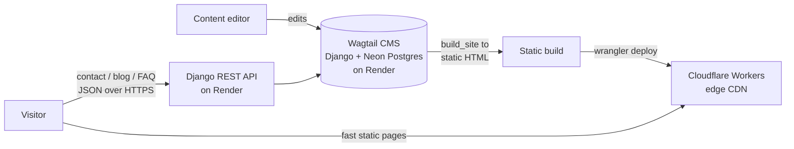

# DigiAgentic — A Full Product, Built Solo (Idea → Brand → Code → Live)

> A production digital-agency platform I took from a blank page to a deployed, tested, edge-served product — **concept, branding, UI/UX, full-stack development, testing, and CI/CD** — using AI-assisted development to move at a team's pace alone.

**Live:** [digiagentic.in](https://digiagentic.in) · **Stack:** Django 5 · Wagtail 6 · DRF · Cloudflare Workers · Render · Neon Postgres

---

## TL;DR

I built an entire digital-agency product end to end — not just the code. I defined the brand, designed the experience, chose the architecture, wrote the backend and front end, added a test suite, set up a 3-environment CI/CD pipeline across two cloud platforms, and shipped it live. Along the way I debugged and hardened real production issues (CORS, rate-limiting behind a CDN, email on an SMTP-blocked host, a silent API bug). I used **prompt engineering and AI-assisted development** as a force-multiplier, and I can explain every architectural decision in it.

---

## 1. The problem

A small business needs a website that actually brings in customers, but every normal option has a catch:

- **WordPress** — easy to edit, but slow, frequently hacked, and needs paid hosting + constant upkeep.
- **Hand-coded** — fast and secure, but every content change needs a developer, so the owner is stuck waiting.
- **Website builders (Wix/Squarespace)** — simple but generic, limited, and a forever monthly bill.

**The goal:** one site that is *editor-manageable, fast, secure, discoverable, and nearly free to run* — without choosing between flexibility and performance.

---

## 2. How I started → how it ended (the full flow)

I treated this like a real product, and ran the complete lifecycle:

| Phase | What I did |
|------:|------------|
| **1. Idea & positioning** | Defined DigiAgentic as a digital-presence agency; wrote the value proposition and the audience. |
| **2. Branding** | Built the identity — name, logo direction, voice, and a **brand palette** (indigo `#212467`, gold `#fbc731`, teal `#208281`) with typography (Poppins / Lora). |
| **3. Brand manual** | Codified the brand as reusable design tokens (CSS custom properties) so every page stays consistent. |
| **4. UI/UX design** | Designed the page flows, the hero "orbit" concept, the service architecture, and the content model. |
| **5. Architecture** | Chose a **headless-CMS → static-build → edge** architecture (the key decision — see §4). |
| **6. Development** | Built the Wagtail backend + Django REST APIs and the responsive front end. |
| **7. Testing & QA** | Wrote **43 automated tests** + a written test plan; found and fixed a real bug. |
| **8. CI/CD & deploy** | Set up a 3-environment pipeline (`local → uat → main`) auto-deploying to Cloudflare + Render. |
| **9. Hardening** | Fixed production issues: CORS, rate-limiting behind a CDN, email delivery, private-file exposure, secret-key safety. |

**Where it ended:** a live, content-managed site that loads like a static site from Cloudflare's global edge, backed by a Django API on Render, with automated tests and a repeatable deploy process.

---

## 3. What makes the solution unique

Instead of choosing between "CMS flexibility" and "static speed," the architecture **separates the CMS from what the public ever sees**:

- Editors work in a **headless Wagtail CMS** (drafts, media, structured content blocks).
- A build step **compiles the whole site to static HTML** and ships it to **Cloudflare Workers** at the edge.
- The public **never touches the database or the admin** — they hit static files on a global CDN.
- The few genuinely dynamic pieces (contact form, blog/FAQ JSON APIs) run as a small **Django REST API on Render**, called over HTTPS.

**Result:** a CMS-managed site that serves like a static one — fast everywhere, no public attack surface, and it stays up even if the backend sleeps.

---

## 4. Problems I solved (the engineering, in detail)

**CMS flexibility *and* static performance** — Wagtail runs headless; a `build_site` step renders every page to static HTML for the edge. Editors get a CMS; visitors get static files.

**Full-text search on a static site** — static sites can't query a DB, so I used **Pagefind** to build a search index at deploy time and search it entirely client-side.

**Email on a host that blocks SMTP** — Render's free tier blocks outbound SMTP, which silently hung requests. Fixed two ways: send notifications in a **background daemon thread** (so email can never block or fail the response), and switch from SMTP to **SendGrid's HTTPS API**, which Render allows.

**Rate-limiting that works behind a CDN** — a naive IP limit breaks behind Cloudflare (everyone shares the proxy IP). I keyed the throttle on **`CF-Connecting-IP`** (the true client IP Cloudflare sets) and added a **honeypot** field to reject bots.

**True responsive "auto-layout" (320px to 2560px)** — one shared `--page-content-width` token aligns every page and the navbar, and `grid-template-columns: repeat(auto-fit, minmax(min(100%, 320px), 1fr))` makes card grids reflow at *any* width with no new breakpoints. Verified by an automated sweep across **15 pages x 12 widths**.

**A silent API bug I caught** — a DRF serializer declared `source="slug"` equal to its field name, which raises `AssertionError`; a broad `try/except` swallowed it, so the blog API returned empty for *every* request. Caught by a test that asserts the API actually returns data.

**Secure by construction** — a startup guard refuses to boot production with an insecure `SECRET_KEY`; an `.assetsignore` keeps private documents and tooling state off the public deploy; strict CORS, HSTS, and secure cookies in production.

**Built for AI answer engines (AEO/GEO)** — configured Cloudflare AI Crawl Control to let ChatGPT/Claude/Perplexity crawl the site, and added JSON-LD structured data — so the brand can be *recommended by AI assistants*, not only ranked by Google.

---

## 5. Skills demonstrated

**Product & design** — Product thinking · brand identity & design system · UI/UX design · content modelling

**Backend (Python)** — Python · Django 5 · Wagtail (headless CMS) · Django REST Framework · REST API design · serializers & validation · ORM / models / migrations · background threading · rate-limiting

**Frontend** — HTML · modern CSS (Grid, Flexbox, `clamp`, custom properties, responsive design) · vanilla JavaScript (fetch, form handling, client-side validation)

**Databases** — PostgreSQL (Neon) · SQLite (local)

**DevOps / Cloud** — Git & GitHub (branching, merging, 3-tier workflow) · CI/CD · Cloudflare Workers + CDN · Wrangler CLI · Render · environment & secrets management · Cloudinary

**Testing & quality** — Automated testing (Django `APITestCase`) · boundary/edge/error test design · debugging · written test plans

**Security & integration** — CORS · honeypot anti-spam · SendGrid API integration · HTTPS/HSTS hardening

**Ways of working** — AI-assisted development & **prompt engineering**: directing AI to compress a team's worth of work (branding → UX → full-stack → QA → deploy) into a solo build.

---

## 6. Architecture & tech stack

| Layer | Choice | Why |
|-------|--------|-----|
| CMS / backend | **Django 5 + Wagtail 6** | Rich headless CMS, structured content blocks |
| API | **Django REST Framework** | Contact / blog / FAQ JSON endpoints |
| Database | **Neon (Serverless Postgres)** | Managed, scales to zero |
| Media | **Cloudinary** | Free image CDN + transforms |
| Backend host | **Render** | Auto-deploy from `main` |
| Frontend host | **Cloudflare Workers** (static assets) | Global edge, free tier |
| Search | **Pagefind** | Client-side search on a static site |
| Front end | **Hand-built HTML/CSS/JS** | No framework weight; fully responsive |
| CI/CD | **GitHub → Render auto-deploy**, **Wrangler** for the edge | `local / uat / main` |

---

## 7. Results

- **Static, edge-served public site** — fast global loads, no public DB/attack surface, resilient to backend downtime.
- **Editor-managed content** without developer involvement.
- **Responsive at every width** from small phones to 50-inch displays, verified automatically.
- **AI-discoverable** (AEO/GEO) in addition to classic SEO.
- Runs on **free / low-cost tiers** end to end.

---

## 8. What I'd improve next

- Add CI to run the test suite automatically on every push (GitHub Actions) before deploy.
- Move email fully to a provider API with delivery monitoring.
- Add analytics + a Lighthouse budget to the pipeline to track performance over time.

---

*Designed, built, tested, and deployed by **Rajan Gupta**. [GitHub](https://github.com/Rajangupta17) · [LinkedIn](https://linkedin.com/in/rajangupta28)*
